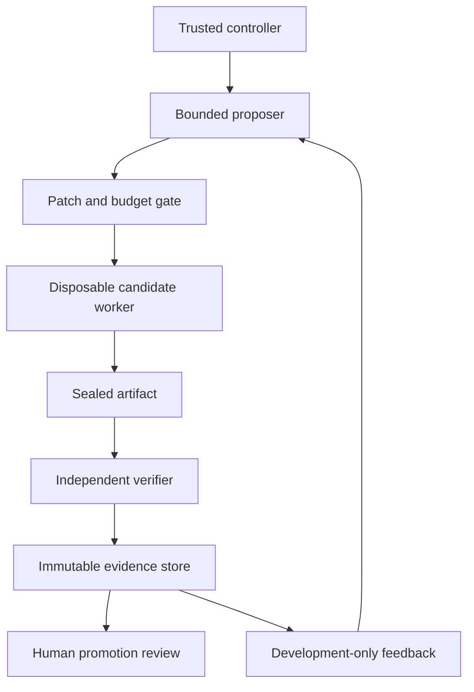

# System architecture

Status: target architecture with offline contracts/planning and a public synthetic reference/verifier implemented. An offline container capability probe and a pinned Harbor separate-verifier policy spike are implemented as infrastructure checks. Full worker isolation, protected final assessment and automated research execution remain unimplemented. Reviewed declarative-policy replay now uses pre-existing sealed inputs; see SEALED_REPLAY.md. A host-observed audit of Harbor's actual container configuration, with a reviewed grade-forgery control, records remaining isolation gaps; see HARBOR_AUDIT.md. Three application tasks (read, list/search, CSV) run model-free under that layout, with candidate code isolated from the verifier and sealed replays; see APPLICATION_TASKS.md. Runtime step 5 is implemented for the submission of these Harbor tasks: a trusted collector extracts the one allowlisted file after the agent's container stops. Harbor's re-upload of the agent-written `/logs/artifacts` directory is excluded while the agent's container accepts execs; an agent that prevents that forces an unfiltered copy, which host acceptance detects and rejects. Container storage (submission volumes, `/tmp`, `/dev/shm`, container logs) is size-bounded per trial and audited; the trial directory Harbor bind-mounts and copies into is bounded only by the host until a worker host gives each trial its own bounded filesystem (see HARBOR_AUDIT.md, Bounded storage). See also REFERENCE.md, WORKER_PROBE.md and HARBOR.md.

## Three separate authority domains

The controller coordinates work; the candidate worker contains untrusted code; the verifier owns judgments. Separate agent names and directories do not provide isolation. Filesystem access, execution identity, network policy and credentials must enforce the boundaries.

## Components and future module locations

| Component | Target location | Responsibility and boundary |
| --- | --- | --- |
| Contracts | `src/democratize_security/contracts.py` | Implemented v1 offline campaign validation/planning; expand with versioned records |
| CLI | `src/democratize_security/cli.py` | Implemented `validate`, `plan`, `seal` and `inspect-artifact`; no execution CLI |
| Controller | future `controller/` within Python package | Reserve budgets, schedule finite trials, persist transitions; never import workload code |
| Store | `src/democratize_security/store.py` | Implemented offline plans, immutable events and synthetic reservation/settlement accounting; immutable artifact references pin synthetic verifier intent; verifier-result evidence, full recovery and backup remain future work |
| Runner adapters | `adapters/runners/` | Harbor first; current reviewed-data spike is `scripts/harbor_spike.py`, not a production adapter. The stdlib Harbor boundary audit lives in `adapters/runners/harbor_audit.py`; the core must not import it. `scripts/harbor_apps.py` runs the three application tasks in `tasks/harbor/invoice-*`. See HARBOR.md, HARBOR_AUDIT.md and APPLICATION_TASKS.md |
| Benchmark adapters | future `adapters/benchmarks/` | Prepare/inject/extract/normalize; preserve original scoring and task provenance |
| Proposer adapters | future `adapters/proposers/` | Manual candidate initially, GEPA later; development feedback only |
| Security integration | `candidates/` | Prompts/templates/helpers/policies that the product ships; cannot define authoritative grades |
| Verifier | `src/democratize_security/verification/` | Public fixed-fixture HTTP/database checks implemented and bound to sealed artifacts in the Harbor tasks, which collect them through a trusted collector (runtime step 5); protected verification remains future work |
| Reporting | future `reports/` | Aggregate all scheduled outcomes, costs, uncertainty and limitations |

Do not create empty plugin classes for every hypothetical future integration. Add a module when its first concrete behavior and tests are implemented.

## Runtime flow

1. Validate and freeze the campaign, task/split manifests, scoring and allowed edits.
2. Propose one candidate and review its diff against an explicit path/size allowlist.
3. Reserve bounded maximum trial cost before dispatch. Missing prices or unbounded model calls prohibit unattended execution.
4. Prepare one disposable worker with only the public task, candidate and allowed tools. Scoped model access must not expose infrastructure credentials.
5. Stop the worker, extract allowlisted regular files, reject traversal/symlinks/special files, bound size and seal a SHA-256 bundle.
6. Verify that exact bundle in a fresh environment with separate credentials and tests outside candidate reach. Installation/build steps also execute as untrusted code.
7. Store verdicts bound to artifact and verifier versions. Detailed development diagnostics may go back to the proposer. Final cases and feedback do not.
8. Human review decides promotion using frozen criteria and complete evidence.

## Product enforcement boundary

Trusted authentication resolves organization membership on the server. Transaction-scoped tenant context is bound to a restricted PostgreSQL runtime role. RLS restricts rows; the app returns own-tenant records through FastAPI. A separate setup identity creates synthetic data and database policies. Runtime credentials must not own tables, bypass RLS, create policies or perform broad privileged operations.

The verifier must check roles/policies, actual API response bodies and CSV contents, including connection reuse and failed transactions. An app that returns no data to anyone is not a successful protection mechanism. See the access matrix and exclusions in `THREAT_MODEL.md`.

## Storage and lifecycle

The proposed M3 [persistence/recovery contract](PERSISTENCE.md) and
[ADR 0004](decisions/0004-persistence-recovery.md) refine the lifecycle below
with durable dispatch intent and explicit reconciliation. The wider runtime semantics remain a design for review. Store v3 implements
only offline plans, synthetic accounting and immutable artifact bindings; it grants no execution permission.

Git stores reviewed source, public task metadata and campaign configurations. SQLite initially stores trial identities, state transitions, reservations, usage and evidence locations. Artifacts live in a separate content-addressed directory. Private final cases live outside the repository, its history and agent images. Backups must preserve the database and artifact index together.

Planned lifecycle: `planned -> preparing -> running -> sealed -> verifying -> completed`. Failures/timeouts can produce `interrupted` with explicit reason and retained evidence. A completed trial may still fail functionality or security. Restart reconciles leases with actual workers; it must never blindly create a second paid attempt. These runtime semantics are not yet implemented.

## Evolution without a rewrite

- Add a new security property with a threat contract, positive/negative references, independent verifier and scoped evidence before reuse claims.
- Add a framework through a candidate integration and task adapter while preserving result schemas.
- Replace local workers with remote disposable workers behind the runner interface when measured capacity requires it.
- Replace SQLite when multiple controller writers justify the complexity; preserve exported versioned JSON records.
- Build optional UI/services over stable CLI/contracts after external users demonstrate a need.
- Version changes to scoring, task transformations and trust assumptions; never retroactively relabel old results.

## Development environment is not a research sandbox

Codespaces/dev containers support trusted project editing. They are not approved containment for arbitrary generated programs or vulnerability benchmarks. Before execution, verify dedicated-worker isolation, resource limits, network controls, clean replay and absence of verifier material from the candidate environment.
